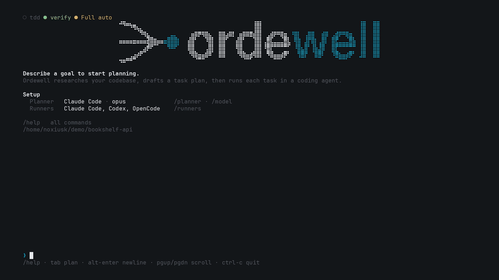

<p align="center">
  <picture>
    <source media="(prefers-color-scheme: dark)" srcset="assets/readme/logo-dark.png">
    
  </picture>
</p>

<p align="center">
  <strong>Stop juggling agent tabs. Talk to one planner.</strong><br>
  It runs Claude Code, Codex and OpenCode for you, in plain sight, and nothing runs until you approve.
</p>

<p align="center">
  <a href="https://ordewell.ai"><strong>Website</strong></a> ·
  <a href="https://ordewell.ai/docs">Documentation</a> ·
  <a href="https://ordewell.ai/news">News</a>
</p>

<p align="center">
  <a href="LICENSE"></a>
  <a href="https://www.npmjs.com/package/@ordewell/cli"></a>
  <a href="https://github.com/ordewell/ordewell/actions/workflows/ci.yml"></a>
  <a href="https://github.com/ordewell/ordewell"></a>
</p>

<p align="center">
  
</p>

Describe what you want to build. Ordewell explores your repository, asks clarifying
questions, and turns your goal into a plan you can read and edit. Run independent
tasks in parallel, review the changes, and merge into your branch. Submitted build
plans wait for your approval by default; run settings let you automate execution
and merging.

Claude Code, Codex and OpenCode are supported out of the box, and can be mixed
freely within one plan. Try it in your project, with nothing to install:

```bash
npx ordewell
```

This README describes 0.11.3. See the [published releases](https://github.com/ordewell/ordewell/releases)
for versions available to install and their release notes.

Ordewell is pre-1.0, so minor releases can include breaking changes. Read the
[changelog](CHANGELOG.md) before you upgrade.

## Features

<table>
  <tr><td><b>Editable plans</b></td><td>Change prompts, dependencies and each task's runner, model, thinking effort or mode before execution.</td></tr>
  <tr><td><b>Worktree isolation</b></td><td>Use separate git worktrees for code tasks, with an integration branch for review and merging. See <a href="#how-it-works">How it works</a> for shared workspace behavior.</td></tr>
  <tr><td><b>Loops</b></td><td>Repeat tasks in response to a check until it passes or reaches its round limit.</td></tr>
  <tr><td><b>Ops and scripts</b></td><td>Put deployments and other operations in the plan with dependencies. Run exact commands as script tasks without a model, under your approval and run settings.</td></tr>
  <tr><td><b>Read-only tasks</b></td><td>Review, audit or prototype without landing changes. Research tasks report back to the planner while you keep talking.</td></tr>
  <tr><td><b>Completion reports</b></td><td>AI tasks pass their completion check with a <code>task_complete</code> report marked <code>done</code>; scripts use exit status. Task handoffs share summaries, findings and evidence. Review the diff and test evidence before merging.</td></tr>
  <tr><td><b>Run controls</b></td><td>Let the supervisor watch and suggest, or act within limits you set. Choose autorun and automatic merging in <code>/settings</code>.</td></tr>
  <tr><td><b>Usage limits</b></td><td>A task that hits its agent's account limit pauses. Claude Code and Codex name the reset, and the task then continues in its saved session, while Ordewell is running. After a restart it waits for you to resume it. OpenCode names no reset, so its tasks wait for you. Move a paused task to another agent and its unfinished work comes with it.</td></tr>
  <tr><td><b>Planner choices</b></td><td>Plan with a supported coding agent without an extra API key, or use an API provider. The planner reads your repository; changes run through tasks in the plan.</td></tr>
  <tr><td><b>Interfaces</b></td><td>Use the terminal UI, VS Code extension, CLI or local API. Follow live task logs and see account usage limits alongside context and cost.</td></tr>
  <tr><td><b>Skills</b></td><td>Share your team's instructions in repository skills that the planner attaches to tasks across runners.</td></tr>
</table>

## Installation

`npx ordewell` runs it without installing. To keep it:

```bash
npm install -g ordewell
```

For VS Code, install [Ordewell from the Marketplace](https://marketplace.visualstudio.com/items?itemName=ordewell.ordewell)
or run `code --install-extension ordewell.ordewell`. In Cursor, Windsurf or VSCodium,
get it from [Open VSX](https://open-vsx.org/extension/ordewell/ordewell). The
extension bundles its own core and needs nothing from npm.

**Requirements:** Node.js 20.3 or newer, at least one of Claude Code, Codex or
OpenCode, and git for task isolation.

### Windows

| Surface | On Windows |
| --- | --- |
| VS Code extension and its local daemon | Supported natively |
| Terminal UI (`ordewell`) | Not verified on native Windows. Run it under [WSL](https://learn.microsoft.com/windows/wsl/install) |

To run your first goal natively, in PowerShell:

```powershell
code --install-extension ordewell.ordewell
claude --version    # or: codex --version, opencode --version
```

Then open your project folder in VS Code, open the Ordewell panel from the
activity bar, type a goal, review the plan and approve it. At least one runner
must be installed and on your `PATH`; if it is greyed out right after
installing, reload the window. Ordewell finds npm-installed runners (`.cmd` and
`.exe` shims) on Windows.

Most of the Windows support is tested on Linux, through the seams that stand
in for Windows. On a Windows host, only how npm-installed runners are launched
has been measured, and no first run from goal to merge has been watched end to
end ([ADR-0010](docs/adr/platform/0010-windows-support.md)). Two things are
known to be open: whether Codex's read-only sandbox is enforced, and `%VAR%`
expansion on the `cmd.exe` shim route. The planner's shell also has no OS
sandbox on Windows and relies on its command rules alone; see
[troubleshooting](docs/troubleshooting.md).

## What Ordewell sends

Once a day, Ordewell asks ordewell.ai whether a newer version is out. The request
carries two things: the version you run and a random install ID, kept in
`~/.ordewell/version-check.json` and shared by the CLI and the VS Code extension.
The ID is replaced every 30 days. Nothing else is sent: no code, prompts, paths,
file names or account details. Like any server, ordewell.ai sees the IP address
the request comes from.

The first time Ordewell starts on a machine, it shows a notice saying this and
sends nothing. The first check happens on a later start. If Ordewell cannot write
that file, it shows no notice and never sends anything. When a newer version is
out, Ordewell shows one line naming it.

To turn the check off, set `ORDEWELL_NO_VERSION_CHECK=1` or `DO_NOT_TRACK=1`, or
turn off VS Code's telemetry for the extension. Turned off, Ordewell sends
nothing and writes no install ID.

## Quick start

Run `ordewell` in your project to open the terminal UI, then type a goal. The first
run lets you pick a planner and runners with `/planner` and `/runners`.

The same workflow is available from the command line:

```bash
export AI_PROVIDER=claude-code      # plan with Claude Code, Codex or OpenCode

ordewell plan --goal "Add rate limiting to the public API"
ordewell run
ordewell handoff review             # read the diff
ordewell handoff merge              # bring it onto your branch
```

Between `plan` and `run`, the plan is yours to edit:

```bash
ordewell task-runner 2 opencode     # move a task to another agent
ordewell task-model 3 sonnet        # or just change its model
ordewell task-deps 3 1,2            # make it wait for tasks 1 and 2
```

Tried it? [Tell us how your first run went](https://github.com/ordewell/ordewell/discussions/115).

## See it in action

<p align="center">
  
  <br>
  <sub>A real run, sped up where marked. <a href="https://ordewell.ai/assets/demo.mp4">Watch the full 48 seconds</a>.</sub>
</p>

## How it works

1. **Describe your goal.** The planner explores your workspace without modifying
   it and asks clarifying questions.
2. **Review the plan.** Read the tasks and their dependencies. Edit prompts, agent
   assignments and models before execution. To automate execution, turn autorun
   on in `/settings` and submitted build plans start automatically. Script tasks
   still follow their consent rules.
3. **Run the tasks.** Each AI task starts a coding agent session; script tasks
   run their commands without a model. Independent tasks run in parallel;
   dependent tasks wait for the work they need. With worktree isolation enabled,
   code changes stay on separate branches. Follow each task's progress live.
4. **Review and merge.** Ordewell combines the changes for your review. Read the
   diff and test evidence, then merge into your branch or discard the run. You
   can also enable automatic merging or allow an Act supervisor to merge in
   `/settings`. If a task or a merge needs your attention, Ordewell shows you where.

Autorun and automatic merging are off by default, and the supervisor starts at
Watch. During planning, research tasks can start without build-plan approval,
and script tasks can run with consent under your approval and run settings.

The commits Ordewell writes (a task's merge, work a task left uncommitted, a
conflict repair, the merge into your branch) end with a `Planned-with: Ordewell`
line, a git trailer that `git interpret-trailers` reads. Commits a coding agent
made itself are not changed. To leave the line out, run `ordewell trailer off`
(or set `"plannedWithTrailer": false` in `settings.json`); the next commit
follows it.

The planner only reads; tasks run as you, in the mode the plan assigns. A new
installation starts in Guarded, where a task gets its runner's safe mode; Full
gives it the runner's autonomous mode. For exactly what each part can touch and
what to use for untrusted repositories, see
[SECURITY.md](SECURITY.md#what-each-part-can-touch).

Without a git repository, or when isolation is disabled, tasks share the workspace
folder. With isolation enabled, a code task in a workspace containing several
repositories gets a worktree of each isolated repository; its changes land in all
of them or none. Ops and script tasks run at the workspace root. Dependencies,
environment files and loose files beside a repository group can still be shared
between worktrees. See
[isolation and handoff](https://ordewell.ai/docs#isolation) for details.

## Documentation

The [documentation](https://ordewell.ai/docs) covers the planner options, skills,
commands, configuration and platform notes. Design decisions, including the options
that were rejected, are recorded as [architecture decision records](docs/adr/), and
[CONTEXT.md](CONTEXT.md) defines the project's vocabulary. For how the planner and
the runners each get their models and credentials, see
[planners and runners](docs/planners-and-runners.md). To write your own
planner or task skills, see the [skills guide](docs/skills.md). If Codex's
sandbox cannot start on your machine, see [troubleshooting](docs/troubleshooting.md).

## Where it's going

- **Next:** bounded, standing consent for running on its own ([#23](https://github.com/ordewell/ordewell/issues/23)), an escalation inbox across surfaces ([#30](https://github.com/ordewell/ordewell/issues/30)) and a daemon that resumes plans after a restart ([#31](https://github.com/ordewell/ordewell/issues/31)).
- **In 0.11.0:** a planner that can start consented script tasks ([#107](https://github.com/ordewell/ordewell/issues/107)), read with a sandboxed shell that can loop and script ([#64](https://github.com/ordewell/ordewell/issues/64), [#109](https://github.com/ordewell/ordewell/issues/109)), keep talking while research tasks report back ([#111](https://github.com/ordewell/ordewell/issues/111)), and plan check-and-fix loops ([#118](https://github.com/ordewell/ordewell/issues/118)).
- **Shipped in 0.10:** the supervisor, which watches a run and, if you let it, acts within limits you set.

The full roadmap, and where to help, is in [#21](https://github.com/ordewell/ordewell/issues/21).

## Contributing

Contributions are welcome. Please read [CONTRIBUTING.md](CONTRIBUTING.md) for the
build order and project layout, and report security issues through
[SECURITY.md](SECURITY.md) rather than the public tracker.

Good places to start are the issues labelled
[good first issue](https://github.com/ordewell/ordewell/issues?q=is%3Aopen+label%3A%22good+first+issue%22)
and the [runner integrations](https://github.com/ordewell/ordewell/issues?q=is%3Aopen+label%3A%22runner+integration%22)
that are open for help.

## Acknowledgements

The grilling, spec, architecture and TDD skills are
adapted from [Matt Pocock's skills](https://github.com/mattpocock/skills) (MIT).

## License

Ordewell is licensed under the [Apache License 2.0](LICENSE). The Ordewell name and
logos are not covered by this license; see [NOTICE](NOTICE).
